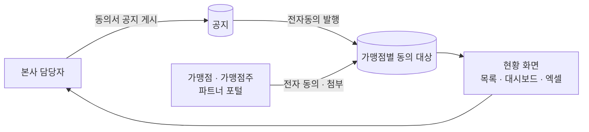

# 전자동의 · 전자동의 현황 (Salesforce Experience Cloud)

> 프랜차이즈 기업 고객사의 가맹점 포털에서, 본사가 동의서를 게시하면 가맹점이 전자로 동의하고 본사는 가맹점별 동의 현황을 한눈에 관리하는 기능을 개발했습니다.

| 항목 | 내용 |
|---|---|
| 기간 | 2026 |
| 역할 | 전자동의 발행 · 현황 관리 기능 개발 (Apex 컨트롤러 약 1,600줄) |
| 형태 | 회사 프로젝트 (고객사 구축) |
| 기술 | Apex, LWC, Experience Cloud(파트너 포털), SOQL 집계, 엑셀 내보내기 |

> 회사 프로젝트를 정리한 문서입니다. 고객사 이름, 가맹점 정보, 실데이터, 회사 소스 코드는 포함하지 않습니다.

## 흐름



## 한 일

### 전자동의 발행
- 본사가 동의서 공지를 게시하면, 대상 가맹점마다 동의 이력을 한 번에 만들어 발행
- 동의 이력은 공지 단위로 묶여 있어 다음 동의서를 게시해도 이전 이력이 섞이지 않음

### 전자동의 현황
- **목록**: 가맹점 · 가맹점주별 동의 상태, 동의일, 첨부 파일. 서버 페이지 나눔으로 많은 가맹점도 빠르게 조회
- **대시보드**: 동의율을 **가맹점 수 기준**과 **가맹점주 기준** 두 가지로 집계 (한 가맹점주가 여러 매장을 운영하는 경우를 구분)
- **필터**: 지역, 담당 팀으로 좁혀 보기
- **미입력 판별**: 지금 게시 중인 동의서를 기준으로 아직 동의하지 않은 가맹점을 골라냄
- **엑셀 내보내기**: 화면 조건 그대로 전체 목록을 내려받기

## 예제 코드

전자동의 발행과 현황 집계 방식을 **독립적으로 다시 구현한 예제**입니다. 회사 코드가 아니며, 커스텀 오브젝트 없이 Wrapper 클래스로 동작을 확인할 수 있습니다.

| 파일 | 역할 |
|---|---|
| [`ConsentPublisher.cls`](force-app/main/default/classes/ConsentPublisher.cls) | 동의서 공지 게시 시 영업 중인 가맹점마다 동의 대상 생성. (공지, 가맹점) 조합으로 중복 발행 방지, 공지 단위로 이력 분리 |
| [`ConsentStatusService.cls`](force-app/main/default/classes/ConsentStatusService.cls) | 가맹점 기준 · 가맹점주 기준 동의율 집계, 지역 · 팀 · 미동의 필터, 페이지 나눔 |
| `*_Test.cls` | 테스트 8개 — 두 기준 동의율 차이, 재발행, 새 공지, 1,000개 매장, 페이지 범위 |

```apex
// 점주 A 가 매장 3개 중 2개만 동의, 점주 B 는 1개 모두 동의
// → 가맹점 기준 75.0%, 가맹점주 기준 50.0%
ConsentStatusService.Summary summary = ConsentStatusService.summarize(rows);
```

### 직접 실행

```bash
sf org create scratch -f config/project-scratch-def.json -a consent-demo
sf project deploy start -o consent-demo -d force-app --test-level RunLocalTests
```

## 배운 점

- 같은 데이터라도 "매장 수"로 보느냐 "점주 수"로 보느냐에 따라 숫자가 달라져서, 현업이 실제로 묻는 질문에 맞춰 집계 기준을 나눠야 한다는 것
- 파트너 포털 사용자와 본사 사용자가 같은 레코드를 다루므로, 화면보다 공유와 조회 범위를 먼저 설계해야 한다는 것
